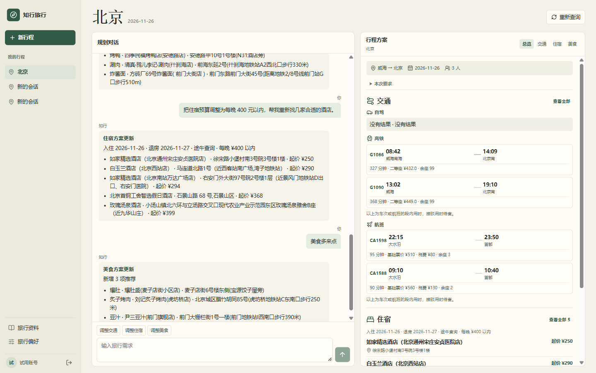
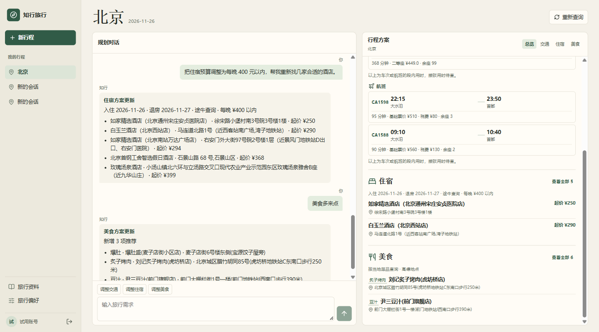

# 知行旅行助手

知行是一款面向自由行的对话式旅行规划助手，覆盖从收集出行需求到查询、整理和调整方案的过程。用户可以在对话中逐步明确出发地、目的地、日期和同行人数，并在同一个工作区查看交通、住宿和美食方案。

行程和对话会保存到账号下。计划发生变化时，可以回到原行程继续补充条件，更新后的方案会汇总到右侧。知行也支持管理长期出行偏好和私人旅行资料，供后续规划参考。

## 界面截图

### 对话规划与行程总览



### 对话跟进与方案调整



## 本地运行

页面使用 Vue 3，Maven 打包时会一并构建前端。

需要 JDK 17、Maven、Node.js 22.18+ 和 Docker Compose。Windows 可以使用 Docker Desktop 或已有的 WSL Docker。以下命令在包含本工程 `pom.xml` 的目录执行。

```powershell
./tools/start-local.ps1 -StartMiddleware -Build
```

打开 [本机应用](http://localhost:10020/api/)，注册自己的账号。第一次执行会补齐本机 `.env` 的数据库、Redis 与签名配置。用户资料、计划和偏好保存到该工程独立的 PostgreSQL，近期记忆使用自己的 Redis。默认端口是 PostgreSQL 25432、Redis 26379。

启用真实规划前，在本工程 `.env` 填写 `DASHSCOPE_API_KEY`。地图、地点和餐厅查询使用高德地图，在 `.env` 中将高德 Web 服务 Key 填入 `AMAP_MAPS_API_KEY`。

国内机票、火车票、酒店可以共用一个途牛 Key。在[途牛开放平台](https://open.tuniu.com/mcp/)注册、创建应用并获取 API Key，然后填入 `TUNIU_API_KEY`。留空对应的 `TRAVEL_MCP_FLIGHT_URL`、`TRAVEL_MCP_TRAIN_URL`、`TRAVEL_MCP_HOTEL_URL` 时，应用自动接入途牛官方查询工具。

```powershell
./tools/start-local.ps1 -StartMiddleware -Models -Mcp
```

需要另外接入时间、天气、机票、住宿、火车票或搜索服务时，为对应的 `TRAVEL_MCP_TIME_URL`、`TRAVEL_MCP_WEATHER_URL`、`TRAVEL_MCP_FLIGHT_URL`、`TRAVEL_MCP_HOTEL_URL`、`TRAVEL_MCP_TRAIN_URL` 或 `TRAVEL_MCP_SEARCH_URL` 填入自己的 MCP 服务地址。若使用 ModelScope 托管的端点，同时配置该账号的 `TRAVEL_MCP_API_KEY`。未配置的服务不会被调用。

数据由 Docker 卷保存。关闭应用的 PowerShell 终端即可停止 Java 服务；后续启动会复用已有数据。
