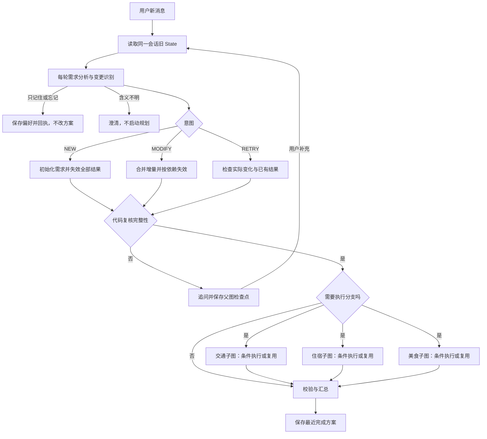

# 02：规划修改与知识库边界

## 本篇目标

把完成后的修改接回同一条业务链，理解需求 State、分支失效和结果复用。按原文需求收集 → 并行规划 → 交通子图 → RAG → Checkpoint 的顺序阅读；对应原文多 Agent/图（1781～4025 行）、RAG（4718～5562 行）、Checkpoint（5563 行起）。意图识别、增量合并和局部重跑属于本次工程增强，不声称原文已有这些能力。原始课程文档与附件未修改。

## 具体业务场景

第一轮：“北京去上海，2026-12-01，两人，整体希望安静。”需求完整后执行交通、住宿、美食。

第二轮：“只把美食换成清淡口味。”沿用旧需求，增加 foodPreferences，只调用美食 Agent。第三轮：“目的地改成西安。”按依赖使三类结果失效，全部重跑。第四轮：“重试刚才的请求。”仍分析消息，但没有变化就复用结果。

明确说“重新查询最新车次”属于修改/刷新，交通分支重新查询；明确说“新建另一趟旅行”则清空旧需求，缺什么就追问什么。

## 分步调用流程与源码入口

1. [ChatServiceImpl.chat](../../src/main/java/cn/zhixing/travel/service/impl/ChatServiceImpl.java) 核验用户与会话归属，使用会话锁串行推进。消息正常保存；只有完整方案写入 latest_plan，追问保留在消息和检查点，不覆盖上次完成方案。
2. [RequirementAgent.runState / collect](../../src/main/java/cn/zhixing/travel/agent/requirement/RequirementAgent.java) 读取同一 threadId 的旧检查点。追问后恢复到 collect；完成后或失败后的新消息携带旧 State 从 collect 开始，不能跳过需求分析。
3. [需求分析提示词](../../src/main/resources/docs/sys_agent/RequirementAgent.txt) 输出 NEW、MODIFY、RETRY、需求增量、受影响分支和明确清除的字段。程序传入的 requirements 是当前需求依据，旧聊天记忆不能恢复已清除字段。
4. [RequirementChanges.apply](../../src/main/java/cn/zhixing/travel/agent/requirement/RequirementChanges.java) 合并需求并判断依赖。NEW 从空本次需求开始；MODIFY 沿用旧字段，非空增量覆盖；clearFields 表示明确删除。长期默认值另算 effectiveRequirements，不回写原始条件，见 [三层记忆与偏好规划](04-三层记忆与偏好规划.md)。返回新的 Requirements，避免原地修改旧检查点对象。
5. [TravelWorkflowState](../../src/main/java/cn/zhixing/travel/agent/state/TravelWorkflowState.java) 保存合并需求、意图、affectedBranches、缺项和分支结果。代码复核 origin、destination、startDate、people、special 五项；三个专属偏好可选，不能仅信模型返回的 missing。
6. 缺项走 askMissing 并暂停。受影响结果在暂停前已清空，交通三种子方案一起失效。后续补齐时，空结果仍判为需要执行，避免跨轮补信息漏重跑。
7. 完整需求进入 planParallel，每个子图入口根据影响范围走执行或复用。交通仍执行自驾、火车、飞机并汇总；[美食 Agent](../../src/main/java/cn/zhixing/travel/agent/food/FoodPlannerAgent.java) 和 [住宿 Agent](../../src/main/java/cn/zhixing/travel/agent/accommodation/AccommodationPlannerAgent.java) 都接收完整需求 JSON，读取专属偏好。
8. 子图适配节点只交回自己拥有的结果字段，不能用整份旧 State 覆盖其他并行结果。assemble 检查需求与结果完整后汇总；完全无变化时，从 collect 直接进入 assemble，不运行规划 Agent。

## 关键设计和边界

| 变化 | 代码确定的重跑范围 | 原因 |
|---|---|---|
| 新规划 | 全部 | 不继承上一趟行程条件 |
| origin | 交通 | 改变出发路线 |
| destination / startDate / people / special | 全部 | 目的地、时间、人数、全局限制影响全部结果 |
| transportPreferences | 交通 | 交通专属偏好 |
| accommodationPreferences | 住宿 | 住宿专属偏好 |
| foodPreferences | 美食 | 美食专属偏好 |
| 长期偏好变化 | 有效条件变化的类别 | 本次已有覆盖时不额外重跑 |
| 只有摘要更新 | 无 | 摘要不作为需求变化 |
| 只说换推荐或刷新某分支 | 指定分支 | 字段相同仍可要求重跑 |
| 单纯重试、资料版本未变且已有完整结果 | 无 | 复用上次查询结果 |
| 上传或删除个人资料 | 全部 | 避免复用基于旧资料生成的结果 |
| 结果缺失或已失效 | 缺失分支 | 没有有效旧结果可复用 |

影响范围取“代码字段依赖与有效输入指纹 + 模型声明分支 + 缺失结果”的并集。本次偏好优先，继承、覆盖和忽略模式独立保存；同版本相同需求复用时也复核当前有效偏好。模型把改目的地只标成 food，代码仍重跑全部。若模型把清淡口味错误写成 special，则保守重跑全部。准确意图与字段提取仍依赖真实模型质量，不能用替身测试证明识别率。

有效需求、长期默认值的实际影响与资料版本均未变化的相同请求重试仍调用需求分析 Agent，节省的是规划 Agent 和工具调用。复用不会自动刷新动态价格，用户明确要求刷新时重新查询。本次没有实现按过期时间自动刷新、跨实例会话互斥或外部工具恰好一次执行。

[AgentFactory](../../src/main/java/cn/zhixing/travel/config/AgentFactory.java) 使用父分支与交通子任务两个独立线程池，避免父任务等待子任务时占满同一个池。检查点统一保存父图状态，子图内部不单独存检查点；并行阶段失败后，尚未合入父图的分支可能再次执行，不能称作任意节点断点续跑。

Requirements 保留旧版 serialVersionUID，新增偏好字段默认为 null，保持旧对象序列化检查点可读。latest_plan 是最近完成方案；正在修改但缺项时，当前需求和失效结果以检查点为准。

### RAG 当前用途与实时工具职责

当前已改为用户上传的私人旅行资料库，完整链路见 [03：私人资料上传与 RAG 检索](03-私人资料上传与RAG检索.md)。上传好友攻略、游记和避雷记录后，只有本人 READY 资料可检索；没有资料时直接跳过检索模型调用。工程自带的西安、深圳攻略仍保留为示例文件，不再随启动导入，也不会无条件提供给所有用户。

RAG 在受影响的规划 Agent 调用模型前提供相关片段；价格、车次、余票、天气和房态仍通过实时工具查询。来源标签随片段进入上下文，提示词要求在既有推荐理由中注明参考文件。资料里有历史价格，不代表当前价格可直接采用。

原 RagConfig 全局文件加载和未实现的 RagTool 已由认证上传接口替代。上传时父段持久化到子段 metadata，重启后仍可回填；删除会停止新检索并清理向量。缓存键包含用户和资料版本，工作流也会在资料版本变化后使旧方案失效。

首次增强前，本机向量表曾实查为 0 条；不能把该次盘点当作后续上传量。当前内容应按 [只读盘点 SQL](../../database/03-rag-inventory.sql) 检查，测试导入的资料已清理。当前没有宣称具备真实用户资料或真实模型检索质量指标。

### 验证结果（2026-11-20）

上一轮规划增强验证为 18 项通过，失败 0、错误 0、跳过 0，并打包成功。后续私人资料链路加入后的当前验证见 03。其中工作流测试 13 项，覆盖新规划、完成后局部修改、改目的地全量重跑、改出发地只跑交通、多分支修改、无字段变化换推荐、相同请求复用、清除日期再恢复、失败后新消息重新分析、空结果拒绝汇总。

另有 2 项真实 PostgreSQL 测试：新图与新 Saver 恢复暂停状态；新图读取完成状态后只执行美食，验证交通及住宿 Agent 零调用。其余测试覆盖资料父段重建、会话归属和 Spring 上下文。模型、Embedding、外部工具仍使用明确替身或不调用，未验证真实自然语言识别率、推荐质量和 MCP 数据。

完整日志：[full-test.log](../../.codex-work/planning-revision-20261120/full-test.log)。修改前备份：[before.zip](../../.codex-work/planning-revision-20261120/before.zip)。文档链接只做静态路径检查，不等同于 VS Code 界面点击验证。

## 本篇自查

1. 为什么不能继续用旧 missing=false 决定是否分析需求？
2. 只换几家餐厅没有改变字段，为什么仍能重跑？
3. 先取消日期再补日期，怎样避免复用旧结果？
4. 有两份示例攻略，能否说已经有用户私人知识库数据？
5. 并行子图为什么不能交回整份 State？

## 自查解答

1. missing 只描述上轮完整性，不描述本轮是否修改需求；每轮都需分析，再合并与校验。
2. MODIFY 声明 affectedBranches=[food] 即可使美食结果失效，其他分支复用。
3. 清除 startDate 时立即使全部结果失效并保存检查点；补日期后空结果仍触发重跑。
4. 不能。示例文件不自动入库；私人资料必须由用户上传，完成解析、向量化并发布 READY 后才参与本人检索。测试数据也不等于真实用户数据。
5. 子图带有其他分支的旧值，整份返回可能覆盖刚生成的新结果，所以只交回本分支输出。
